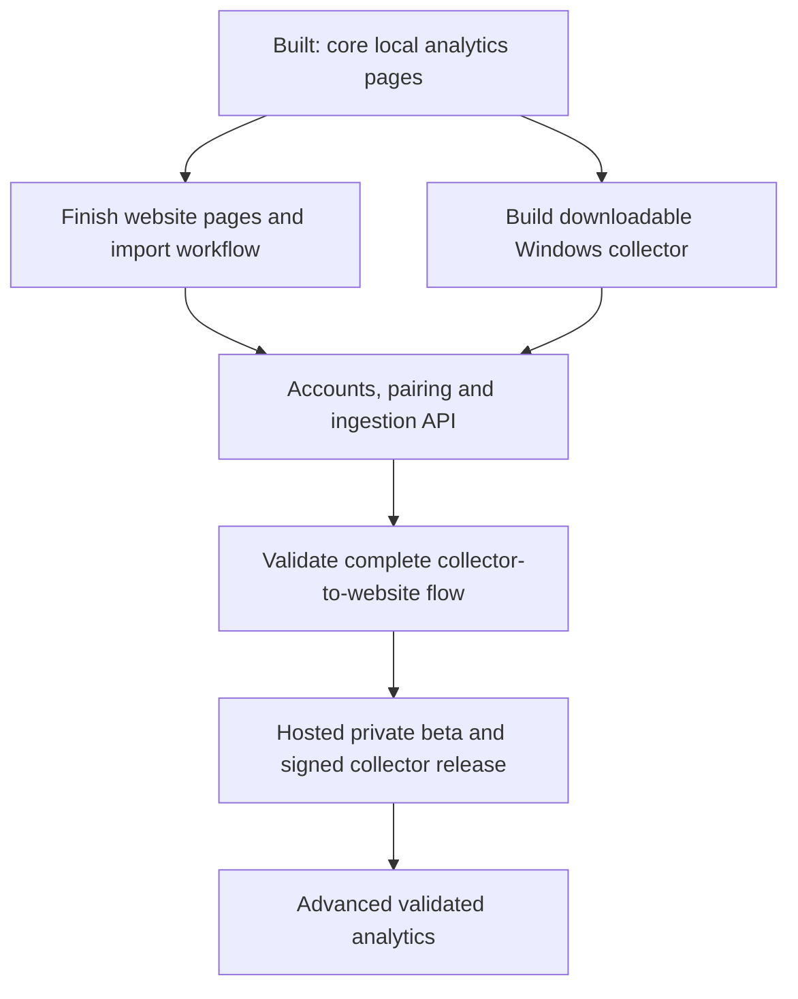

# BREACH development roadmap

Updated October 14, 2026. Account workspaces, Auth0 sign-in and collector 0.3.0 authenticated uploads are now implemented and tested locally. See [workspace and sync](WORKSPACE_SYNC.md) for the current data boundaries and validation.

 BREACH has a working local replay analytics MVP. The full product includes both the website and a downloadable Windows PC collector. The remaining work includes shared team invitations, verified game-account linking, hosted deployment, second-PC testing and signed distribution. Personal workspaces and the authenticated collector-to-website path are implemented.

“Built” means implemented and checked in the development code. It does not mean publicly hosted or ready for production. Compare Players and Insights & Reports are on the pushed `feature/real-compare-and-insights` branch at `4d78242`; the latest remote merge state has not been reverified.

## Development map

## What works now

| Area | Development status | Current behavior |
| --- | --- | --- |
| Frontend foundation | Built | React, TypeScript, Vite, shared layouts and preserved demo UI |
| Data foundation | Built for local use | ASP.NET Core API and SQL Server LocalDB with imported match, round, player and event records |
| Replay importer | Local tooling implemented | Validation, deduplication, completion checks and optional watch mode; website now exposes committed batches and recorded warnings; older batches lack completion timestamps |
| Downloadable PC collector | Local Windows preview built | Folder detection/browse, scan/watch/pause, bundled parser, contract adapter, durable SQLite queue, JSON export and unsigned per-user installer; Auth0 uploads, deduplication and retries built; second-PC testing remains |
| Command Overview | Built | Player/squad perspective, date ranges, results and analytics |
| Squads | Built for local use | Database-backed five-player rosters, version checks and legacy import |
| Match Center | Built | Search/filter archive, reports, scoreboards, rounds, events and exports |
| Player Directory | Built | Player cards, search/sort, profiles, history and operator usage |
| Map Intelligence | Built | Map records, attack/defense rates, objective-site performance and history |
| Operator Intel | Built | Pick share, round win rates, K/D, filters and expandable evidence |
| Compare Players | Built on latest feature branch | Two-player comparison, shared-match filtering, operator usage and JSON export |
| Insights & Reports | Built on latest feature branch | Selected-scope summaries, measured trends, sample checks and JSON/CSV exports |
| Settings | Built for local use | Real database/API diagnostics, persisted density and tracking scope, match and review exports |
| Manual Entry / Review | Built for local use | SQL-backed match/round/player annotations, separate correction proposals and withdrawal history |
| Live Operations / Collector Setup | Built for local use | Committed import batches, warnings, contract downloads and local JSON preflight; authenticated collector connections in My Workspace; no during-match telemetry |
| Collector data contract | Implemented in local preview | Full schema and semantic validation; real six-round replay passed both collector and website preflight; future upload protocol documented |
| Accounts and hosted access | Auth0 and personal workspaces built | Shared gameplay catalogue; private account controls and upload receipts. Team invitations and production hosting remain |

The most recent browser/export checks used 15 imported matches and 98 rounds. There are 63 authored tests across seven suites, plus API integration scripts and importer tests. Updated CI installs from the lockfile, runs the tests and builds both frontend and backend. Remote CI execution remains to be verified after pushing.

## Existing navigation milestone: implemented locally

Settings, Manual Review, collection activity and Collector Setup are implemented and browser-checked. See [local workflows](REAL_WORKFLOWS.md) and [collector contract](COLLECTOR_DATA_CONTRACT.md). Review migration 002 is additive and was applied to the development database. Existing application navigation routes now have real-data implementations; future account, onboarding, download and help pages remain below. The following describes acceptance and remaining service dependencies.

1. **Real settings and diagnostics.** Replace fictional workspace details in Real Data mode. Show database/API status, record counts, current source and verified preferences. Keep real and demo exports clearly distinguished.
2. **Real Manual Entry / Review.** Store match-linked notes and annotations persistently. Define structured manual records and corrections separately from imported facts, with attribution and an audit trail. Retain original replay data.
3. **Import Center and collector status.** Surface last successful import, new/failed/held imports, validation issues, parser version and data freshness. Add JSON import/export validation and refresh after successful imports. Show collector connection/last-seen/setup states when the collector is connected.
4. **Live Operations page responsibility.** Build a real activity/status page for collector health and new imported matches. Genuine during-match telemetry needs its own validated source; post-match replay watching alone does not provide it.
5. **Additional product pages.** Build login/account flows, team/workspace onboarding and invites, collector download/setup, connection management, and public landing/help pages as their supporting services are implemented. Preserve the demo styling across these pages.
6. **Source verification.** Confirm the site-inferred Villa and Coastline identities against the replay/game or a verified parser ID table. Expose missing measurements and import warnings alongside affected records.
7. **Local setup and recovery.** Provide a reliable startup/setup checklist, additive schema migrations and a tested database backup/restore workflow. Update README and architecture documentation, which still describe the older demo-only foundation.

Acceptance: the existing application navigation has real page implementations and honest capability states. A local user can configure the app, review a match, identify the active source, inspect import failures and export current data without fictional workspace information. Authentication and collector connection pages are completed alongside their services, not counted as functional because a mock screen exists.

## Downloadable Windows PC collector

The collector is a first-class product deliverable. Reuse the existing importer and parser where appropriate, but build a standalone experience that does not require users to install Python, run terminal commands or maintain SQL Server LocalDB.

### Data flow

```mermaid
flowchart LR
    A[PC MatchReplay .rec files] --> B[BREACH collector watches completed replays]
    B --> C[Parser extracts JSON]
    C --> D[Validate and normalize versioned records]
    D --> E[Local queue and JSON export]
    E --> F[Authenticated upload to BREACH API]
    F --> G[Validate, deduplicate and store per account/team]
    G --> H[Website status and analytics refresh]
```

The game replay files need to be parsed into JSON; the website cannot automatically access a player's local game folder. The current importer writes to the developer's LocalDB. The collector preview now has its own local queue; the authenticated API upload path is implemented in collector 0.3.0.

### Local collector milestone — implemented, second-PC acceptance pending

The private preview is implemented in [collector/](../collector/README.md). Twenty-two collector integrity/queue tests pass. The packaged app scanned and exported a real six-round/42-event match; bundled-runtime checks and an isolated install/uninstall test passed. Original game files and the SQL database were not modified. Release signing, automatic updates and second-PC verification remain.

- Detect common PC installation locations and let the user select the replay folder.
- Package the parser/runtime with a Windows installer and desktop or tray interface.
- Watch stable, completed replay files; validate and normalize output using a shared versioned JSON contract.
- Show connection, parsing, queued, failed and uploaded states with readable errors and diagnostic logs.
- Keep a durable offline queue, retry failures and retain stable IDs/checksums for deduplication.
- Support manual rescan, pause/resume and local JSON export before cloud synchronization is available.
- Provide explicit startup preferences, uninstall behavior, queue retention and data deletion controls.
- Test on a second Windows PC without the developer's Python, SQL Server or folder configuration.

Acceptance: a tester can install the collector, select their replay folder, play supported matches and obtain validated JSON with no development tooling or terminal use. Existing game/replay files remain intact.

### Website pairing and sync milestone — personal account flow implemented

- Pair the collector with an authenticated BREACH account and permitted workspace.
- Store collector credentials using protected OS storage and support disconnect/revocation.
- Add authenticated batch-ingestion endpoints with schema/version validation, ownership checks and idempotent uploads.
- Record ingestion jobs, partial failures, parser versions and data freshness for the website Import Center.
- Acknowledge successful uploads before clearing queue items and recover safely after interrupted uploads.
- Verify the path from newly created replay through JSON, ingestion and storage to visible analytics.

Acceptance: an installed collector can synchronize supported records to the correct account/team, recover after being offline, avoid duplicates and display matching upload status in the website.

### Distribution and maintenance milestone

- Build versioned, signed installer releases, a trusted download location and an update/rollback workflow.
- Include the collector download/setup page and troubleshooting guidance.
- Review parser/dependency redistribution requirements and maintain compatibility with game replay changes.
- Monitor parsing/upload failures and validate performance, queue recovery, updates and uninstall behavior.

Acceptance: the collector can be distributed to invited users and maintained after a parser or game-version change.

## Following milestone: reliability and local beta

- Verify the updated test and backend-build GitHub CI jobs after pushing.
- Add browser tests for squad editing, perspective changes, shared-match comparisons, navigation and downloads.
- Check keyboard navigation, mobile/narrow layouts, invalid routes and API/database failure states across all real pages.
- Validate a larger replay sample spanning game versions, incomplete matches, parser failures, unknown IDs and missing statistics.
- Preserve raw provenance and consistent calculation definitions, and consolidate duplicated loading/state logic where it helps maintenance.
- Remove remaining legacy `@ts-nocheck` and broadly typed controllers incrementally; keep the demo experience working.

Acceptance: a second local tester can follow setup instructions, complete the main workflows, and reproduce results. CI checks analytics and backend compilation as well as the frontend build.

## Accounts and team permissions

- Add account authentication, real workspaces, team membership, invites and roles.
- Implement the corresponding account, onboarding, invitation and connection-management website pages.
- Connect collector pairing and authenticated ingestion to the same account/workspace model.
- Enforce ownership/authorization on API queries, squad mutations and exports.
- Define player-data access, retention and deletion behavior, and team onboarding.
- Add persistent review notes and, if corrections are supported, attribution and an audit trail while retaining raw imported records.

Acceptance: two teams can use isolated data with explicit permissions. The development-only squad API is replaced with an authenticated ownership model before public hosting.

## Hosted private beta

- Prepare a production database, migrations and migration of approved development data.
- Deploy frontend and API with production configuration, HTTPS and account-aware access.
- Add backups/restore, logs, error monitoring, availability checks and import job status.
- Deploy and validate collector pairing, authenticated JSON ingestion, status reporting and replay upload fallback alongside the downloadable Windows collector.
- Add public product/onboarding pages and launch documentation for the actual data and distribution model.

Acceptance: invited users can sign in, download/install and pair the collector, import their supported records, use the completed website pages and recover from failed imports without developer intervention.

## Later analytics and collection work

- Validate event identities, timing and objective actions before deriving opening/trade/clutch/KOST metrics.
- Add coaching/review summaries only when data and sample sizes support them.
- Add manual/console review workflows as a separate source with explicit provenance.
- Treat tactical movement/floor plans and genuine live telemetry as separate feasibility work. Do not substitute simulated positions or post-match importing for a live collector.

## Immediate development recommendation

Test the **Windows collector preview on a second PC** next. Then integrate a managed identity provider for sign-in, recovery and MFA; build BREACH workspace membership and authorization, onboarding, collector pairing and authenticated ingestion. Keep Manual Review refinements deferred. CI now includes collector tests alongside frontend tests and backend compilation. Signed distribution and hosted downloads follow end-to-end validation.

Milestone order is based on dependencies, not fixed dates. The website is not complete merely because its seven core analysis screens work. Product completion includes the remaining pages, downloadable collector, account-owned ingestion, operational testing and distribution.
